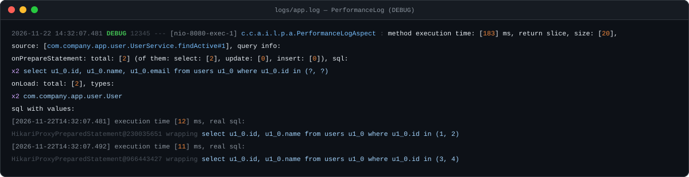

# performance-log-starter

Стартер для поиска проблем производительности JPA-слоя в Spring Boot приложениях.

## Зачем это

Приложение начинает тормозить. На проде нагрузка на БД 80%,
часть ответов не успевает за 30 секунд. Вы включаете логи Hibernate
и видите простыню запросов вперемешку с запросами шедулеров —
непонятно, что именно медленно и откуда оно взялось. Кеш второго
уровня подключили — лучше не стало. С прода прислали топ запросов
по времени, но никто не знает, кто их вызывает.

Этот стартер отвечает на вопрос «что делает мой JPA-слой во время конкретного вызова»:
проксирует выбранные методы, запоминает запросы в БД, схлопывает одинаковые
и пишет статистику в лог.

## Если подключу — производительность не пострадает?

Не пострадает. По умолчанию всё выключено: проксирование, логирование и Hibernate interceptor,
бины стартера не создаются.

## Как включить

1. Добавить зависимость `com.company.app:performance-log-starter` в вашу систему
   сборки (Maven, Gradle — как принято в проекте).

2. Включить модуль. Рабочий вариант — выключено на проде, включено на dev/test,
   пишем только то, что дольше 500 мс:

```yaml
log:
  performance:
    enable: ${LOG_PERFORMANCE_ENABLE:false}
    pointcut-expression: >-
      ${LOG_PERFORMANCE_POINTCUT_EXPRESSION:@annotation(org.springframework.scheduling.annotation.Scheduled)
      || @within(org.springframework.web.bind.annotation.RestController)}
    do-not-write-to-log-methods-whose-execution-time-is-less-than-X-ms: >-
      ${LOG_PERFORMANCE_DO_NOT_WRITE_TO_LOG_METHODS_WHOSE_EXECUTION_TIME_IS_LESS_THAN_X_MS:500}
    write-query-values:
      enable: ${LOG_PERFORMANCE_WRITE_QUERY_VALUES_ENABLE:false}
```

3. Если свой `pointcut-expression` не задан — пометить нужные классы или методы `@PerformanceLog`.

Больше ничего настраивать не нужно: при старте стартер сам поднимает `DEBUG`
для своего пакета и регистрирует Hibernate interceptor и statement inspector.

## Как выглядит лог



В примере: метод выполнялся 183 мс, вернул `Slice` из 20 элементов, выполнил 2 SQL-запроса
(один и тот же select — дважды) и загрузил 2 сущности. Внизу — блок `sql with values`
с реальными значениями параметров вместо `?`.

В логирование входит:

1. время выполнения метода, в мс;
2. размер результата, если это `Collection` или `Slice` (родитель `Page`);
3. источник — полное имя класса и метода;
4. `QueryInfo`: сколько было подготовок запросов (из них select/update/insert), какие SQL и сколько раз,
   сколько сущностей загрузилось и каких типов;
5. при включённом `write-query-values` — реальные SQL с подставленными значениями.

## Как читать статистику

- Каждый залогированный select — запрос, реально ушедший в БД.
- Если запроса в логе нет, значит Hibernate обошёлся без него: сущность уже в persistence context
  или сработал кеш `@Cacheable`.
- `onLoad` показывает, сколько сущностей Hibernate инициализировал, и каких типов.
- Вложенные прокси-методы аккумулируются: внешний вызов видит запросы
  всех вложенных вызовов.

## Реальные SQL со значениями

Флаг `write-query-values.enable` заменяет `?` в логе на реальные значения параметров:

```yaml
log:
  performance:
    enable: true
    write-query-values:
      enable: true
```

```text
sql with values: 
[2026-11-22T14:32:07.481] execution time [12] ms, real sql:
HikariProxyPreparedStatement@230035651 wrapping select u1_0.id, u1_0.name from users u1_0 where u1_0.name in ('Ivan', 'Petr') and u1_0.id in (1, 2)
[2026-11-22T14:32:08.002] interrupt at [1002] ms, real sql:
HikariProxyPreparedStatement@1479770936 wrapping select pg_sleep(5) from users
reason:[ERROR: canceling statement due to statement timeout]
```

Строка берётся из `toString()` JDBC-драйвера, поэтому формат зависит
от драйвера, а значения для `PreparedStatement` подставляет сам драйвер.
Каждый запрос при этом дополнительно приводится к строке, поэтому флаг
заметно сказывается в горячих участках — включайте точечно.

## Параметры

| Параметр | По умолчанию | Описание |
|---|---|---|
| `log.performance.enable` | `false` | включает модуль; при `false` его бины не создаются |
| `log.performance.pointcut-expression` | методы и классы с `@PerformanceLog` | AspectJ pointcut для проксирования |
| `log.performance.do-not-write-to-log-methods-whose-execution-time-is-less-than-X-ms` | `0` | писать только методы дольше N мс |
| `log.performance.write-query-values.enable` | `false` | реальные SQL со значениями (нужен `enable=true`) |

Примеры `pointcut-expression`:

| Что проксировать | Выражение |
|---|---|
| все методы пакета | `execution(* com.company.app.user.*.*(..))` |
| все методы класса | `execution(* com.company.app.user.UserService.*(..))` |
| методы с `@Scheduled` | `@annotation(org.springframework.scheduling.annotation.Scheduled)` |
| методы классов с `@RestController` | `@within(org.springframework.web.bind.annotation.RestController)` |
| методы классов, реализующих интерфейс | `execution(* *(..)) && within(com.company.app.api.Processor+)` |

## Подводные камни

1. `final` класс без интерфейсов не проксируется: CGLIB не может наследоваться
   от `final`, JDK-прокси требует интерфейс. Приложение не поднимется.
2. Hibernate может не выполнить запрос, пока не запросят данные из результата.
3. Внутренний вызов метода (`this.method()`) идёт мимо прокси, лога не будет.

## Как пользоваться в тестах

1. Взять конфиг из `src/test/resources/test.properties`: там уже включены
   `log.performance.enable` и `log.performance.write-query-values.enable`, а `pointcut-expression`
   закомментирован — значит проксируются только методы и классы с `@PerformanceLog`.
2. Повесить `@PerformanceLog` на тестируемый класс или метод.
3. Запустить тест.
4. Искать в логе по фразе `PerformanceLogAspect`.

## Тесты

`mvn test` — unit-тесты и интеграционные тесты на Testcontainers (нужен Docker).

Подробное описание — в javadoc `PerformanceLogConfiguration`.
