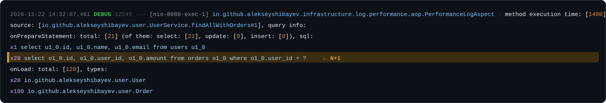

# performance-log-starter

Spring Boot стартер, который показывает, что Hibernate делает во время конкретного вызова:
время метода, SQL-запросы, их повторы и загруженные сущности. Помогает найти медленный
запрос и понять, откуда он взялся (включая N+1).

По умолчанию всё выключено — бины стартера не создаются, на производительность это не влияет.

## Быстрый старт

1. Подключите зависимость `io.github.alekseyshibayev:performance-log-starter` (Maven/Gradle).
2. Включите модуль и задайте, что логировать:

```yaml
log:
  performance:
    enable: ${LOG_PERFORMANCE_ENABLE:false}
    pointcut-expression: >-
      ${LOG_PERFORMANCE_POINTCUT_EXPRESSION:@annotation(org.springframework.scheduling.annotation.Scheduled)
      || @within(org.springframework.web.bind.annotation.RestController)}
    do-not-write-to-log-methods-whose-execution-time-is-less-than-X-ms: >-
      ${LOG_PERFORMANCE_DO_NOT_WRITE_TO_LOG_METHODS_WHOSE_EXECUTION_TIME_IS_LESS_THAN_X_MS:500}
```

`pointcut-expression` — это конфигурация, а не код: чтобы поменять, что логировать,
достаточно поправить его (или переменную окружения) и перезапустить приложение.

## Что пишется в лог



В примере метод вернул 10 пользователей за 1480 мс, но выполнил 11 select: 1 к `users`
и 10 одинаковых к `orders` (N+1, выделено жёлтым).

В лог попадают:

- время выполнения метода (мс);
- размер результата (`Collection`/`Slice`);
- источник — класс и метод;
- `QueryInfo` — SQL-запросы и сколько раз каждый выполнился, сколько и каких сущностей загружено.

Как читать статистику:

- каждый select в логе — запрос, реально ушедший в БД. Нет запроса — Hibernate обошёлся без него:
  сущность уже загружена в рамках транзакции (persistence context, кэш первого уровня)
  или сработал кэш `@Cacheable`;
- вложенные вызовы складываются: внешний вызов видит запросы всех внутренних.

## Реальные значения SQL

Опционально вместо `?` подставляются реальные значения параметров.

```yaml
log:
  performance:
    enable: true
    write-query-values:
      enable: true
```

> Значения пишутся только для профилей `local`, `test`, `dev` — в них могут попасть
> персональные данные. На проде не включайте.

Строка берётся из `toString()` JDBC-драйвера (формат зависит от драйвера). Флаг замедляет
горячие участки — включайте точечно.

## Параметры

| Параметр | По умолчанию | Описание |
|---|---|---|
| `log.performance.enable` | `false` | включает модуль; при `false` бины не создаются |
| `log.performance.pointcut-expression` | `@PerformanceLog` | AspectJ pointcut; по умолчанию проксируются методы и классы, помеченные `@PerformanceLog` |
| `log.performance.do-not-write-to-log-methods-whose-execution-time-is-less-than-X-ms` | `0` | писать только методы дольше N мс |
| `log.performance.write-query-values.enable` | `false` | реальные SQL со значениями (нужен `enable=true`) |

Примеры `pointcut-expression`:

| Что проксировать | Выражение |
|---|---|
| все методы пакета | `execution(* io.github.alekseyshibayev.user.*.*(..))` |
| все методы класса | `execution(* io.github.alekseyshibayev.user.UserService.*(..))` |
| методы с `@Scheduled` | `@annotation(org.springframework.scheduling.annotation.Scheduled)` |
| классы с `@RestController` | `@within(org.springframework.web.bind.annotation.RestController)` |
| классы, реализующие интерфейс | `execution(* *(..)) && within(io.github.alekseyshibayev.api.Processor+)` |

## Подводные камни

- `final` класс без интерфейсов не проксируется — приложение не поднимется.
- Hibernate может не выполнить запрос, пока не запросят данные из результата.
- Внутренний вызов метода (`this.method()`) идёт мимо прокси — лога не будет.
